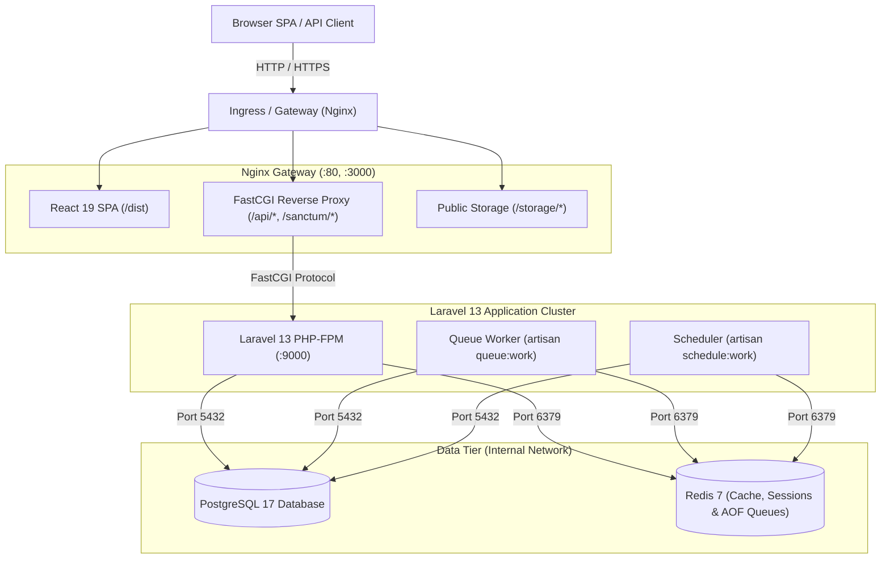
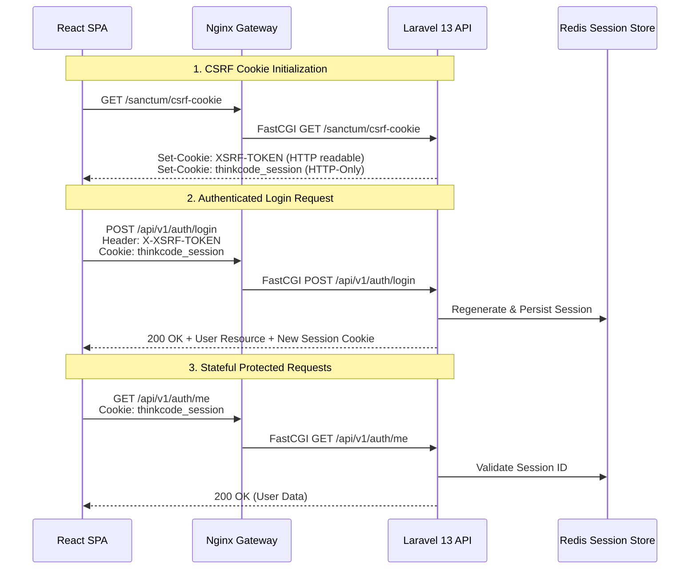

# ThinkCode Full-Stack Template — Technical Design Document

## 1. System Architecture

The application implements a decoupled full-stack architecture optimized for first-party SPA client interaction and third-party API consumers.

---

## 2. Ingress & Routing Topology

### Local Development Topology
In local development, developers can choose between two operational modes:
1. **Full Container Stack (`make up`):**
   - Nginx gateway exposed on host port `8080`.
   - PostgreSQL exposed on host port `5433` (configurable via `FORWARD_DB_PORT`).
   - Redis exposed on host port `6379` (configurable via `FORWARD_REDIS_PORT`).
   - Vite builds static assets inside the Nginx container image.
2. **Hybrid Host Iteration (`make up-deps` + `make dev-backend` + `make dev-frontend`):**
   - PostgreSQL and Redis run in Docker.
   - Vite development server runs on host (`http://localhost:5173`) with Hot Module Replacement (HMR).
   - Vite proxies `/api` and `/sanctum` to the local Laravel development server running on host `http://localhost:8000`.

### Production (Coolify) Topology
1. **Coolify Traefik Ingress:** All internet traffic terminates SSL at Traefik on port 443.
2. **Nginx Service:** Only the `nginx` container has `traefik.enable=true`.
3. **Internal Network:** All backend services communicate exclusively over `thinkcode_network`. No internal ports (PostgreSQL, Redis, PHP-FPM) are published to the host network.
4. **Protocol Propagation:** Traefik injects `X-Forwarded-Proto: https`. Nginx maps this to `$proxy_x_forwarded_proto`, ensuring Laravel generates HTTPS URLs and honors secure session cookies.

---

## 3. Authentication & Security Architecture

### First-Party Browser SPA (Cookie-Based)

1. **CSRF Protection:** Laravel Sanctum sets an `XSRF-TOKEN` cookie. The API client extracts this token and attaches it as `X-XSRF-TOKEN` on all mutating requests (`POST`, `PUT`, `PATCH`, `DELETE`).
2. **CORS Whitelist:** Wildcard origins (`*`) are disallowed when `supports_credentials => true`. Specific frontend domains (e.g., `http://localhost:5173`, `http://localhost:8080`, production client domains) are strictly enumerated in `CORS_ALLOWED_ORIGINS`.
3. **Stateful Domains:** `SANCTUM_STATEFUL_DOMAINS` lists valid SPA hostnames to instruct Sanctum to apply session authentication middleware (`EnsureFrontendRequestsAreStateful`).

### Third-Party / API Clients (Bearer Tokens)
Personal access tokens are decoupled from the browser session flow and managed via dedicated endpoints:
- `POST /api/v1/tokens`: Authenticates credentials (`email`, `password`), requires `token_name`, optional `abilities`, and returns an expiring token (`SANCTUM_TOKEN_EXPIRATION`, default 7 days).
- `GET /api/v1/tokens`: Lists active tokens (ID, name, abilities, expiration) without disclosing plaintext secrets.
- `DELETE /api/v1/tokens/current`: Revokes the token used for the active request.
- `DELETE /api/v1/tokens/{id}`: Revokes a specific token owned by the user.

### Security Hardening Policies
1. **Application-Level Rate Limiting:**
   - Login attempts throttled to 5 per minute per `email|IP` via `throttle:login`.
   - Token issuance throttled to 5 per minute per `email|IP` via `throttle:tokens`.
2. **Registration Toggle:** Controlled via `ALLOW_REGISTRATION=true/false` (`config('auth.registration_enabled')`). Returns 403 Forbidden when disabled.
3. **Information Disclosure Protection:**
   - Failed login responses return uniform `"These credentials do not match our records."` regardless of whether the email exists.
   - Public health check `/api/v1/health/live` only returns `{ "status": "ok" }`.
   - Detailed readiness `/api/v1/health/ready` conceals DB driver names, raw database error traces, and exact software versions in production mode (`APP_DEBUG=false`).
4. **Production Startup Safety:** Container entrypoint aborts immediately if `APP_KEY` is missing in production, preventing session breakage or silent key regeneration. Migrations default to explicit deployment triggers (`RUN_MIGRATIONS=false`).

---

## 4. Error Handling & API Conventions

All API responses follow consistent JSON conventions under the `/api/v1` namespace:

| Scenario | HTTP Status | Response Structure |
| :--- | :--- | :--- |
| **Success** | `200 OK` / `201 Created` | `{ "user": { ... }, "message": "..." }` |
| **Validation Failure** | `422 Unprocessable` | `{ "message": "The given data was invalid.", "errors": { "field": ["message"] } }` |
| **Unauthenticated** | `401 Unauthorized` | `{ "message": "Unauthenticated." }` |
| **Forbidden / Registration Disabled** | `403 Forbidden` | `{ "message": "This action is unauthorized." }` or `{ "message": "Registration is disabled." }` |
| **Not Found** | `404 Not Found` | `{ "message": "Resource not found." }` |
| **Rate Limited** | `429 Too Many Requests` | `{ "message": "Too many login attempts. Please try again later." }` |
| **Server Error** | `500 Internal Error` | `{ "message": "Server error." }` *(Stack traces hidden in prod)* |

---

## 5. Structured Logging & Observability

- **Request Correlation:** The `AssignRequestId` middleware generates a UUID for every incoming request (or reuses `X-Request-ID` / `X-Correlation-ID`), injects it into Monolog context, and echoes it in response headers.
- **Log Sanitation:** Passwords, database secrets, authorization tokens, and payment identifiers are automatically filtered from logs.
- **Log Channels:** Uses Laravel's `stack` logging channel with daily rotation in development and single/stderr streams in production containers.

